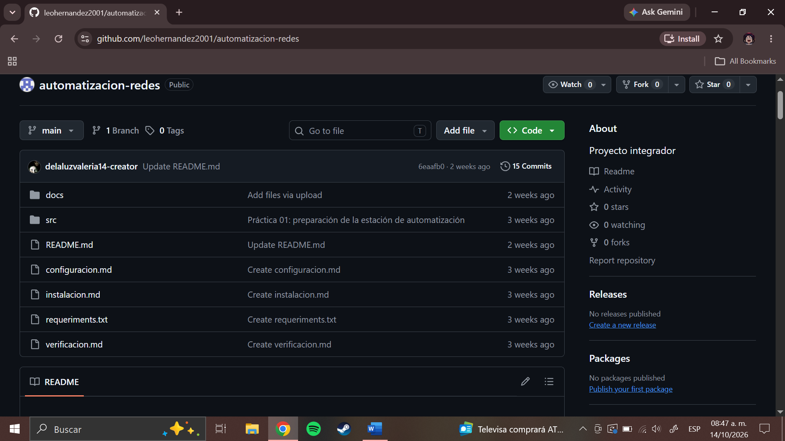

# Práctica 03: Primer programa de Python para representar información de dispositivos

## 1. Propósito
En el desarrollo de esta práctica se elaboró un programa inicial utilizando Python, cuyo objetivo principal fue representar, organizar y mostrar de manera estructurada toda la información básica de los dispositivos que componen una infraestructura de red simulada en GNS3.

## 2. Conceptos utilizados
Durante la elaboración de la práctica se aplicaron los siguientes conceptos:

* **Variables**: Espacios de memoria designados para almacenar valores.
* **Tipos de datos**: Indican qué clase de información se almacena en una variable.
* **print()**: Sirve para mostrar información en la pantalla.
* **Diccionarios**: Organizan los datos de un dispositivo mediante claves y valores.
* **Listas**: Colecciones ordenadas diseñadas para almacenar múltiples elementos o dispositivos en un solo bloque.
* **Ciclo for**: Permite repetir instrucciones para cada elemento de una lista.
* **Condicional if**: Permite ejecutar instrucciones dependiendo de una condición.
* **Funciones**: Agrupan instrucciones para realizar una tarea específica y reutilizar el código.

## 3. Dispositivos representados
La infraestructura simulada se estructuró con base en la topología desarrollada previamente

| Dispositivo | Tipo | Dirección IP | Estado | Función |
|-------------|-------|--------------|--------|----------|
|     R1      | Router |  10.1.1.1    | Activo | Enrutamiento |
|     R2      | Router |  10.1.1.2    | Activo | Enrutamiento |
|     S1      | Switch |  10.1.1.3    | Activo | Conectividad |

## 4. Evidencias
### *1. Estructura del repositorio*

### *2. Código fuente de dispositivos*

### *3. Ejecución del programa*

### *4. Representación de los dispositivos*

### *5. Uso de listas y diccionarios*
.png)
.png)

### *6. Uso de ciclos y estructuras condicionales*
.png)
.png)

### *7. Uso de una función*
.png)
.png)

### *8. Reto Final*
.png)
.png)

## 5. Problemas y soluciones

| Problema | Causa | Solución | 
|-------------|-------|--------------|
|Dificultad para vincular el repositorio con Visual Studio Code.  | Conflicto o pérdida de sesión en el control de versiones.|Reautenticar la cuenta de GitHub en VS Code.| 
|Error en la terminal al intentar ejecutar el script de Python (*No such file*)|Ejecutar el comando desde una carpeta incorrecta|Posicionarse en la carpeta raíz del proyecto usando el comando *cd*. |

## 6. Conclusión

En esta práctica logramos desarrollar con éxito un programa en Python enfocado en organizar,representar y procesar la información de los dispositivos de una infraestructura de red, vinculando los elementos de una topología como los routers y switches de GNS3 con el código, destacando principalmente que integramos el uso de variables, cadenas de texto, listas y diccionarios para registrar de manera ordenada las características de cada equipo incluyendo nombres, direcciones IP y estados, además de emplementar ciclos *for*, condicionales *if* y funciones para recorrer los datos y controlar su presentación, de modo que durante el desarrollo y las pruebas de ejecución fue fundamental revisar con cuidado la estructura y las claves de los diccionarios, así como el acceso a los valores, lo que nos permitió corregir errores y comprobar que la información de los dispositivos se mostrara de forma correcta y sin fallos.

