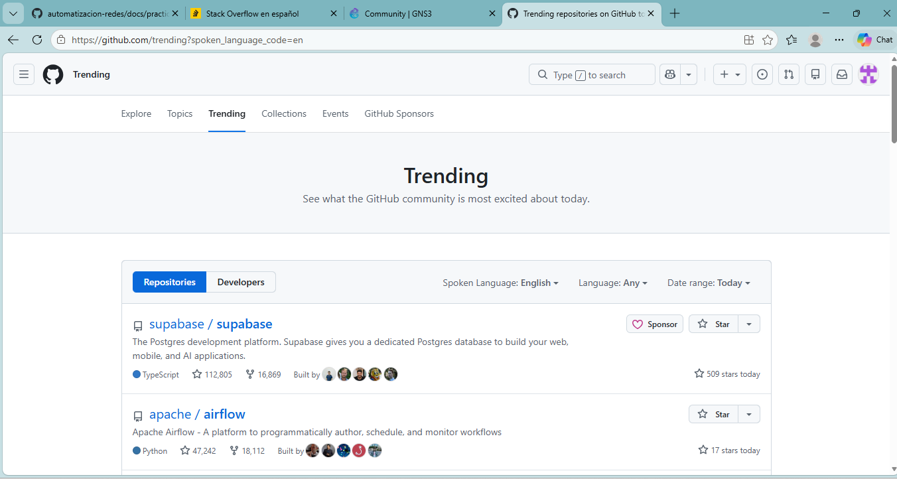

### Espacios de colaboracion
---
| Recurso o comunidad | Tipo de recurso | ¿Qué tipo de problemas ayuda a resolver? | ¿Cómo podría utilizarlo el equipo? | 
| ----- | ----- | ----- | ----- | 
| **Stack Overflow en español** | Foro de preguntas y respuestas | Errores de sintaxis, dudas sobre lógica y fallas comunes en Python. | Para buscar errores similares, comparar opciones de solución y resolver dudas del código. | 
| **GitHub** | Plataforma de desarrollo colaborativo | Problemas al combinar archivos de varios integrantes y desorden en el código. | Para guardar el proyecto, revisar los cambios del equipo y mantener al día la documentación. | 
| **Comunidad de GNS3** | Foro especializado en simulación | Errores de conexión entre Python y los equipos de red simulados. | Para consultar guías sobre cómo conectar scripts con la topología de red. | 
---
* **1. ¿Qué ventajas ofrece una comunidad de colaboración frente a buscar información sin un objetivo definido?**

* **2. ¿Por qué conviene revisar si una pregunta similar ya fue respondida?**

* **3. ¿Qué información debería incluir una pregunta técnica para facilitar que otras personas comprendan el problema?**

* **4. ¿Por qué es importante describir lo que ya se intentó y los errores encontrados?**

* **5. ¿Qué comportamiento debe mantener un estudiante al solicitar ayuda o utilizar una solución publicada por otra persona?**
---

