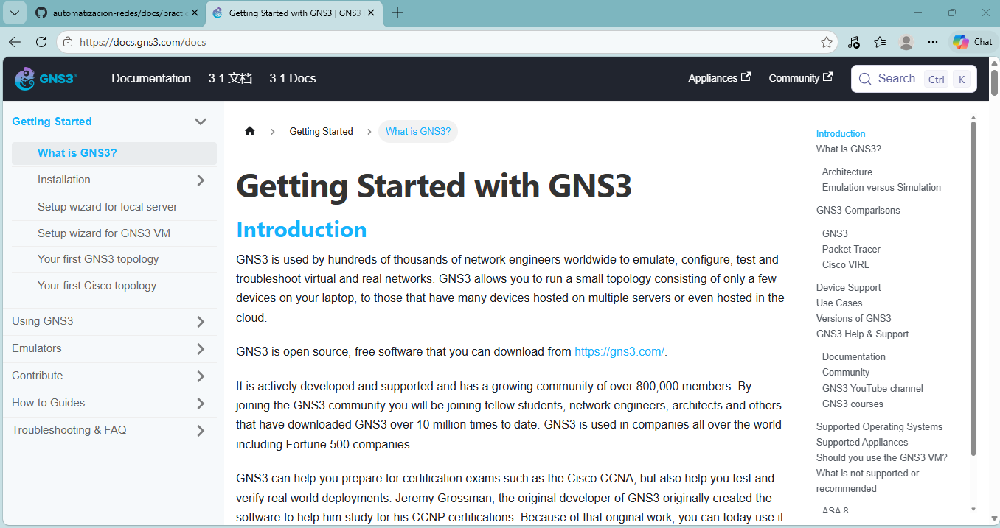

### Recursos de GNS3 y automatización de redes
---
* **1. ¿Qué tipo de problemas podrías resolver consultando la documentación de GNS3?**
Errores de instalación, problemas de integración con hipervisores (como VMware o VirtualBox), dudas sobre la conexión de dispositivos virtuales, o problemas de conectividad entre las máquinas virtuales y la red local.

* **2. ¿Qué diferencia existe entre la documentación de una herramienta y el repositorio de una biblioteca?**
La documentación explica cómo utilizar una herramienta o biblioteca. El repositorio contiene archivos del proyecto, como el código fuente, ejemplos, versiones y reportes de errores.

* **3. ¿Qué información revisarías antes de utilizar una biblioteca de automatización?**
La compatibilidad, las dependencias, los ejemplos de uso y las funciones que ofrece.

* **4. ¿Por qué es importante comprobar qué plataformas y funciones admite una biblioteca?**
Porque cada fabricante de red utiliza comandos, comportamientos de CLI y sintaxis diferentes. Si la biblioteca no admite la plataforma especifica que vas a configurar, los comandos fallarán o no se establecerá la conexión.

* **5. ¿Cómo podrían utilizarse estos recursos en las siguientes prácticas?**
Para aprender a configurar las topologías en GNS3, estableciendo conexiones con dispositivos de red y automatizar las tareas mediante Python y bibliotecas como Netmiko.
---
**Recurso 1** 
* **Nombre del recurso:** Documentación Oficial de GNS3
* **URL:** https://docs.gns3.com/docs
* **Tema que aborda:** Configuración, instalación y uso del simulador GNS3.
* **Tipo de información que ofrece:** Guías paso a paso, solución de errores comunes, instrucciones para importar dispositivos e integrar el entorno con software externo.
* **Utilidad para el proyecto integrador:** Asegurar el entorno de laboratorio virtual. 
* **Ejemplo de una situación en la que lo consultarías:** Cuando se presente un error al configurar una topología o conectar dispositivos en GNS3 y se necesite encontrar una solución.

**Recurso 2** 
* **Nombre del recurso:** Repositorio Oficial de Netmiko
* **URL:** https://github.com/ktbyers/netmiko
* **Tema que aborda:** Desarrollo y mantenimiento de la biblioteca de Netmiko.
* **Tipo de información que ofrece:** Código fuente, instrucciones de instalación, ejemplos, versiones y reportes de errores.
* **Utilidad para el proyecto integrador:** Ayuda a revisar cómo se desarrolla la biblioteca, conocer sus actualizaciones y comporbar qué dispositivos admite.
* **Ejemplo de una situación en la que lo consultarías:** Antes de utilizar Netmiko, para comprobar si admite el sistema operativo de red de dispositivo que se quiera administrar.

**Recurso 3**
* **Nombre del recurso:**  Comunidad de GNS3
* **URL:** https://gns3.com/community/featured
* **Tema que aborda:** Dudas, problemas y experiencias relacionadas con GNS3.
* **Tipo de información que ofrece:** Preguntas, respuestas y recomendaciones de otros usuarios sobre el uso de la herramienta.
* **Utilidad para el proyecto integrador:** Permite encontrar posibles soluciones a errores que surjan durante las prácticas.
* **Ejemplo de una situación en la que lo consultarías:** Cuando GNS3 muestre un error al iniciar un dispositivo y necesite encontrar posibles soluciones.

